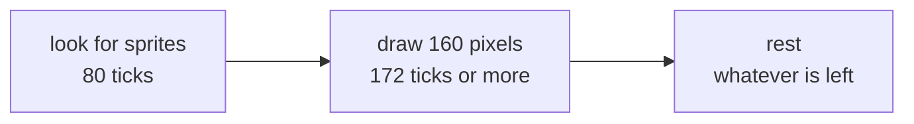
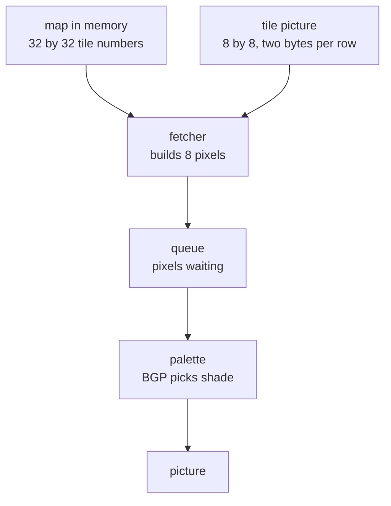
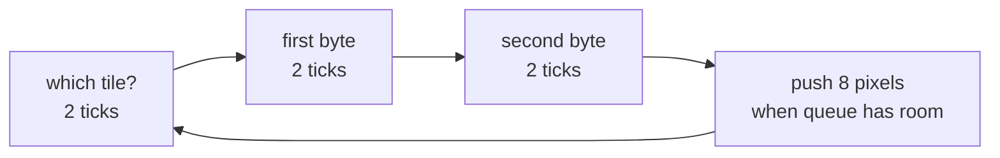

# How screen draws

## Start here

A modern computer keeps a whole picture in memory and hands it to a screen.
A Game Boy cannot. It has nowhere near enough memory for that.

So it cheats. It builds the picture **as the screen is showing it**, one pixel
at a time, left to right, top to bottom, and never keeps a copy. Think of
someone painting a line on a train window while the train is moving. They have
to keep up. If they fall behind, that bit of the window stays blank.

That one fact explains everything else on this page.

---

## Counting in ticks

Everything here is measured in **ticks**. One tick is one beat of the console's
clock, about a quarter of a millionth of a second. Four million of them go by
each second.

A tick is also exactly how long one pixel takes. That is not a coincidence,
it is the whole design.

---

## One line



A line is always **456 ticks**, no matter what happens in it. First the screen
checks which sprites land on this line, then it draws the 160 pixels, then it
sits idle until the 456 are used up.

Screen is 144 lines tall. After those, 10 more lines run with nothing drawn,
which is where a game does its tidying up. That is 154 lines, 456 ticks each,
about 60 pictures a second.

While a line is being drawn the program **cannot touch video memory**. The
screen is reading it, and only one of them can. This is not a rule we invented
to be strict, it is a wire that is physically busy, and games lean on it.

---

## Where a pixel comes from

Nothing in memory says "this pixel is dark grey". The picture is assembled
from two much smaller things.



A **tile** is a little 8 by 8 stamp. A game has a few hundred of them: a brick,
a cloud, a letter.

A **map** is a grid saying which stamp goes where. It holds tile numbers, not
pictures. Put the same brick number in forty map squares and you get a wall,
while the brick itself is stored once.

So to find one pixel: look in map for a tile number, go fetch that tile, pull
out the right row, pick out the right pixel.

---

## Two bytes make eight pixels

A row of a tile is 8 pixels wide and takes **two bytes**. Not one byte per
pixel, two bytes for all eight.

Each pixel gets one bit from each byte. Two bits give four possible values, so
four shades:

```
byte 1   1 0 1 0 0 0 0 0
byte 2   1 1 0 0 0 0 0 0
         | | |
value    3 2 1 0 0 0 0 0
         ^ leftmost pixel
```

Those values are not colours yet. They are more like "slot 1, slot 2". A
separate byte called **BGP** says what each slot looks like, so a game can
recolour everything on screen by changing one byte. Flashing white when you get
hit is one write, not a redraw.

---

## Fetcher and queue

Here is the awkward part. Screen wants exactly one pixel per tick. But pixels
only come 8 at a time, because that is how a tile row is stored.

So there are two workers:



The **fetcher** goes and gets 8 pixels, taking 6 ticks, and drops them in a
queue. The **screen** takes 1 pixel off that queue every tick.

6 ticks of work for 8 ticks of spending, so the fetcher stays comfortably
ahead. When it gets too far ahead it waits, because the queue only holds 16.
That waiting is what makes some lines slower than others.

---

## Why 172 ticks, and why sometimes more

160 pixels should take 160 ticks. It never does.

| What happens | Extra ticks |
|---|---|
| very first fetch of a line is thrown away | 12, always |
| line starts part way into a tile, so some pixels are binned | up to 7 |
| window starts partway along a line | 6 |
| each sprite, when we add them | 6 to 11 |

The first one is a hardware quirk. At the start of each line the fetcher does a
full fetch and the result is dropped on the floor. Nobody designed that on
purpose, it is how the circuit warms up, and emulators have to copy it because
it moves every later timing by 12 ticks.

The second one is scrolling. Scroll sideways by 3 pixels and the first tile is
only three quarters visible, but tiles can only be fetched whole, so 3 pixels
get fetched and binned.

Drawing does not end on a fixed count of 172. It ends when pixel number 160
actually leaves the queue. A slow line
genuinely takes longer, and eats into the rest at the end, because the 456 is
fixed. Games with smooth scrolling rely on exactly this.

---

## It works

A test drops four letter tiles into video memory, points the map at them, and
runs one full frame. Then it reads the finished picture back and prints the
darkest pixels as `#`:

```
    #               #
    #               #
 ####   #   #    ####    ####
#   #   #   #   #   #   #
#   #   #   #   #   #    ###
#   #   #   #   #   #       #
 ####    ####    ####   ####
```

Not one pixel of that was typed by hand. Tiles went in; every pixel came back
out through map, fetcher, queue and palette, one tick at a time.
It is `it_draws_a_word_on_screen` in `ppu/mod.rs`.

---

## Three things stacked

It helps to see all of it at once. There are three separate pictures, and only
the last one is what you see.

```
1. background map : 256 x 256, far bigger than screen, wraps at every edge
   +--------------------------------------------+
   |                                            |
   |            +------------------+            |
   |            |                  |            |
   |            |  what screen     |  <- SCX and SCY say where this
   |            |  can reach       |     patch sits. Moving them is
   |            |   160 x 144      |     how a world scrolls.
   |            +------------------+            |
   |                                            |
   +--------------------------------------------+

2. that patch, on its own                3. window laid over it
   +------------------+                     +------------------+
   |                  |                     |                  |
   |                  |                     |                  |
   |   background     |          ->      WY |- - - +-----------|
   |                  |                     |  bg  |  window   |
   |                  |                     |      |           |
   +------------------+                     +------+-----------+
                                                   ^
                                                 WX - 7
```

The difference between the two layers is only this: **the background moves and
the window does not.**

Slide `SCX` and picture 1's patch slides with it, so the world scrolls. The
window in picture 3 ignores `SCX` completely and stays exactly where `WX` and
`WY` put it. That is the only reason both exist.

And because the window has no map of its own to scroll around, it always reads
from its top-left corner outwards. It has nowhere else to start.

---

## The window, a second layer

The background scrolls. The **window** does not. It is pinned to the glass, and
the world slides underneath it. Every status bar you have seen on a Game Boy is
this: the hearts, the score, the text box at the bottom of a battle.

Two registers put its corner somewhere:

- `WY` is the row it starts on
- `WX` is the column, **plus 7**. So `WX = 7` means the far left. Nobody knows
  why the 7 is there; it is how the chip was wired.

The surprise is that it is not a box. Once it starts, it runs to the right edge
and to the bottom. Always.

```
     0        80       159
   0 +-----------------+
     |                 |
     |   background    |
  72 | - - - +---------|   <- WY
     |  bg   | window  |
 143 +-------+---------+
             ^ WX - 7
```

So a floating box in the middle is impossible. Games that want one draw it into
the background instead, or build it out of sprites.

### There is no second fetcher

The same fetcher does both. When the line reaches the corner it is simply told
three things: throw away the queue, read the other map, start again from tile
zero. From then on it stays on the window until the line ends.

That one-way switch is where the shape comes from. No rectangle is ever
calculated.

### Its own row counter

The window does not use `LY`. It keeps a separate count that only goes up on
lines where it actually drew something.

Sounds fussy, but it is what lets a text box close and reopen without jumping:
the lines where the window was off never moved its counter, so it carries on
exactly where it stopped.

### What it costs

Throwing away the queue means the fetcher has to refill it, and refilling takes
6 ticks. So a line with the window partway along takes 178 instead of 172. That
cost is not coded anywhere, it just happens.

One trap: if the window starts at the very first pixel, the line's own 12-tick
warm up has to finish first, or drawing comes out at 166 and breaks the floor.

### Seeing it

Same trick as before: a word in the background, a window laid over it from row 4
and column 32, read back out of the finished picture.

```
    #               #
    #               #
 ####   #   #    ####    ####
#   #   #   #   #   #   #
#   #   #   #   #   #    ###    ################
#   #   #   #   #   #       #   ################
 ####    ####    ####   ####    ################
                                ################
```

Top rows are untouched. From row 4 the window cuts in at column 32 and takes
everything to the right. `it_draws_a_window_over_the_background` in `ppu/mod.rs`.

---

## Done and not done

| | |
|---|---|
| background layer, scrolling, shades | done |
| window, a second layer | done |
| sprites, things that move independently | PR-16 |
| real colour instead of four greys | PR-17 |

---

## The registers, in one place

Addresses a game writes to steer the screen. `R` means the game can only read it.

| Address | Name | What it is |
|---|---|---|
| FF40 | LCDC | eight switches, listed below |
| FF41 | STAT | what the screen is doing, and which events interrupt |
| FF42 | SCY | background scrolled up by this much |
| FF43 | SCX | background scrolled left by this much |
| FF44 | LY `R` | line being drawn right now, 0 to 153 |
| FF45 | LYC | interrupt when LY reaches this line |
| FF47 | BGP | four greys for background, old console only |
| FF48 | OBP0 | greys for sprites using palette 0, old console only |
| FF49 | OBP1 | greys for sprites using palette 1, old console only |
| FF4A | WY | top edge of window |
| FF4B | WX | left edge of window, plus 7 |
| FF4F | VBK | which of two video memory banks is on show |
| FF68 | BCPS | which background colour slot FF69 will touch |
| FF69 | BCPD | the colour itself |
| FF6A | OCPS | which sprite colour slot FF6B will touch |
| FF6B | OCPD | the colour itself |

### LCDC, bit by bit

| Bit | On means |
|---|---|
| 7 | screen is running at all |
| 6 | window reads map at 9C00, not 9800 |
| 5 | window is drawn |
| 4 | tiles counted up from 8000, not backwards from 9000 |
| 3 | background reads map at 9C00, not 9800 |
| 2 | sprites are 8 by 16, not 8 by 8 |
| 1 | sprites are drawn |
| 0 | background is drawn (on a colour console: tiles may sit in front) |

### The attribute byte

One per sprite, and on a colour console one per map square too, kept in bank 1.

| Bit | Means |
|---|---|
| 7 | sprite: hide behind background. tile: sit in front of sprites |
| 6 | turn upside down |
| 5 | mirror left to right |
| 4 | sprite on an old console: use OBP1 instead of OBP0 |
| 3 | take the picture from bank 1 |
| 0-2 | which of 8 palettes, colour console only |

Each of these bits is read in exactly one place in `ppu/mod.rs`, by a function
named after it, so the numbers above do not appear anywhere else in the code.
