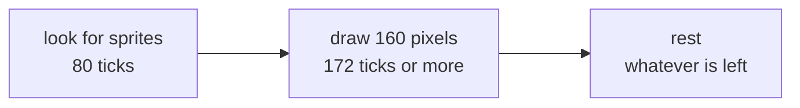
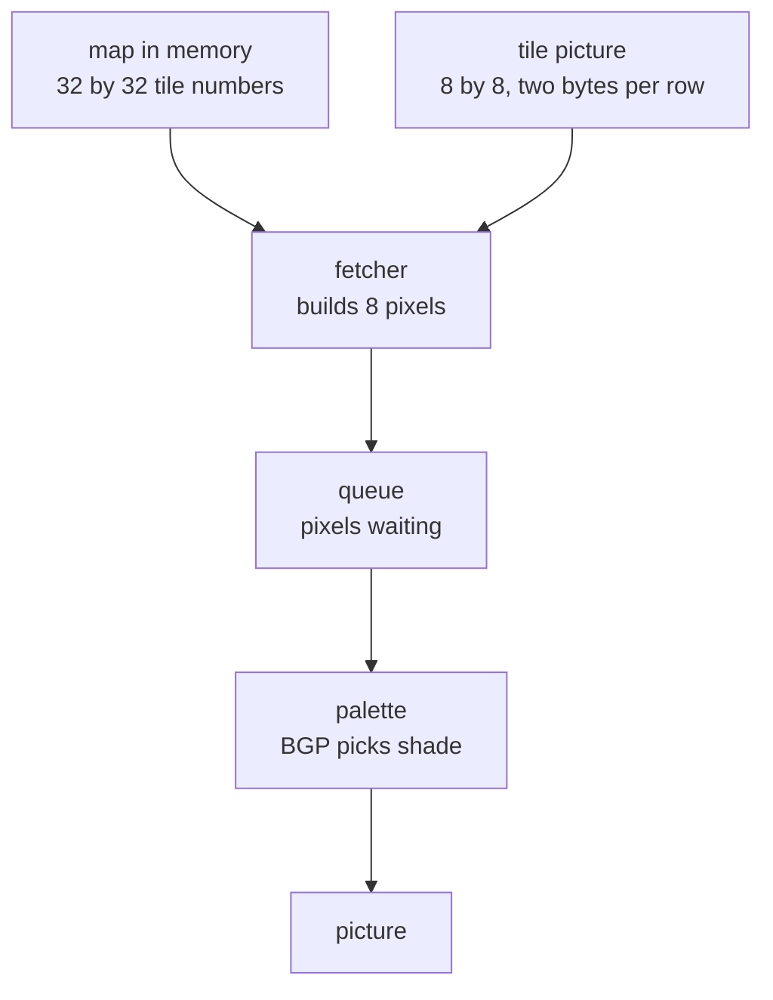
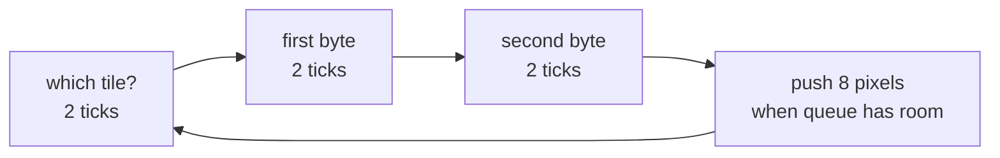

# How screen draws

## Start here

A modern computer keeps a whole picture in memory and hands it to a screen.
A Game Boy cannot. It has nowhere near enough memory for that.

So it cheats. It builds the picture **as the screen is showing it**, one pixel
at a time, left to right, top to bottom, and never keeps a copy. Think of
someone painting a line on a train window while the train is moving. They have
to keep up. If they fall behind, that bit of the window stays blank.

That one fact explains everything else on this page.

---

## Counting in ticks

Everything here is measured in **ticks**. One tick is one beat of the console's
clock, about a quarter of a millionth of a second. Four million of them go by
each second.

A tick is also exactly how long one pixel takes. That is not a coincidence,
it is the whole design.

---

## One line



A line is always **456 ticks**, no matter what happens in it. First the screen
checks which sprites land on this line, then it draws the 160 pixels, then it
sits idle until the 456 are used up.

Screen is 144 lines tall. After those, 10 more lines run with nothing drawn,
which is where a game does its tidying up. That is 154 lines, 456 ticks each,
about 60 pictures a second.

While a line is being drawn the program **cannot touch video memory**. The
screen is reading it, and only one of them can. This is not a rule we invented
to be strict, it is a wire that is physically busy, and games lean on it.

---

## Where a pixel comes from

Nothing in memory says "this pixel is dark grey". The picture is assembled
from two much smaller things.



A **tile** is a little 8 by 8 stamp. A game has a few hundred of them: a brick,
a cloud, a letter.

A **map** is a grid saying which stamp goes where. It holds tile numbers, not
pictures. Put the same brick number in forty map squares and you get a wall,
while the brick itself is stored once.

So to find one pixel: look in map for a tile number, go fetch that tile, pull
out the right row, pick out the right pixel.

---

## Two bytes make eight pixels

A row of a tile is 8 pixels wide and takes **two bytes**. Not one byte per
pixel, two bytes for all eight.

Each pixel gets one bit from each byte. Two bits give four possible values, so
four shades:

```
byte 1   1 0 1 0 0 0 0 0
byte 2   1 1 0 0 0 0 0 0
         | | |
value    3 2 1 0 0 0 0 0
         ^ leftmost pixel
```

Those values are not colours yet. They are more like "slot 1, slot 2". A
separate byte called **BGP** says what each slot looks like, so a game can
recolour everything on screen by changing one byte. Flashing white when you get
hit is one write, not a redraw.

---

## Fetcher and queue

Here is the awkward part. Screen wants exactly one pixel per tick. But pixels
only come 8 at a time, because that is how a tile row is stored.

So there are two workers:



The **fetcher** goes and gets 8 pixels, taking 6 ticks, and drops them in a
queue. The **screen** takes 1 pixel off that queue every tick.

6 ticks of work for 8 ticks of spending, so the fetcher stays comfortably
ahead. When it gets too far ahead it waits, because the queue only holds 16.
That waiting is what makes some lines slower than others.

---

## Why 172 ticks, and why sometimes more

160 pixels should take 160 ticks. It never does.

| What happens | Extra ticks |
|---|---|
| very first fetch of a line is thrown away | 12, always |
| line starts part way into a tile, so some pixels are binned | up to 7 |
| window, when we add it | 6 |
| each sprite, when we add them | 6 to 11 |

The first one is a hardware quirk. At the start of each line the fetcher does a
full fetch and the result is dropped on the floor. Nobody designed that on
purpose, it is how the circuit warms up, and emulators have to copy it because
it moves every later timing by 12 ticks.

The second one is scrolling. Scroll sideways by 3 pixels and the first tile is
only three quarters visible, but tiles can only be fetched whole, so 3 pixels
get fetched and binned.

**This is what changed in this PR.** Drawing used to end on a fixed count of
172. Now it ends when pixel number 160 actually leaves the queue. A slow line
genuinely takes longer, and eats into the rest at the end, because the 456 is
fixed. Games with smooth scrolling rely on exactly this.

---

## It works

A test drops eight letter tiles into video memory, points the map at them, and
runs one full frame. Then it reads the finished picture back and prints the
darkest pixels as `#`:

```
    #               #                   #
    #               #                   #
 ####   #   #    ####    ####           ####     ###    #   #
#   #   #   #   #   #   #               #   #   #   #   #   #
#   #   #   #   #   #    ###            #   #   #   #   #   #
#   #   #   #   #   #       #           #   #   #   #    ####
 ####    ####    ####   ####            ####     ###        #
                                                         ###
```

Not one pixel of that was typed by hand. Tiles went in; every pixel came back
out through map, fetcher, queue and palette, one tick at a time.
It is `it_draws_a_word_on_screen` in `ppu/mod.rs`.

---

## Done and not done

| | |
|---|---|
| background layer, scrolling, shades | done |
| window, a second layer sitting on top | PR-15 |
| sprites, things that move independently | PR-16 |
| real colour instead of four greys | PR-17 |
